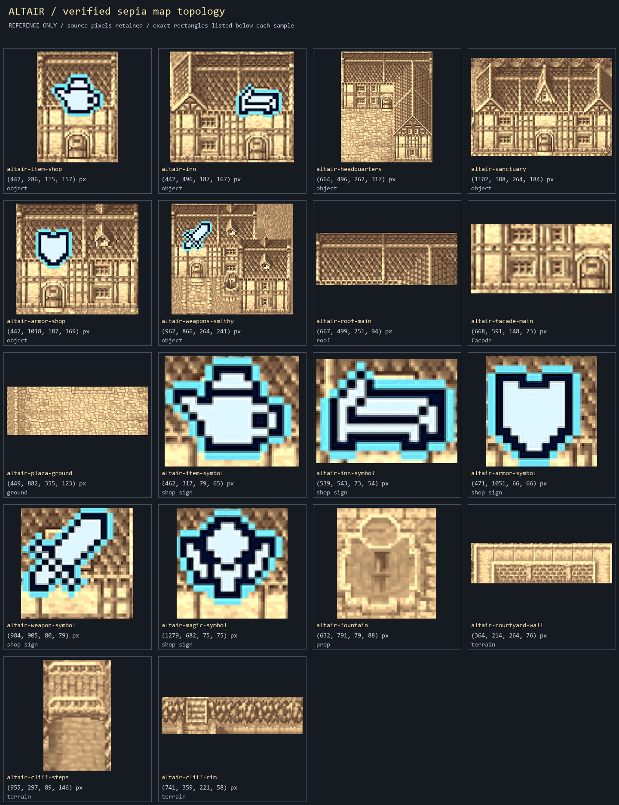
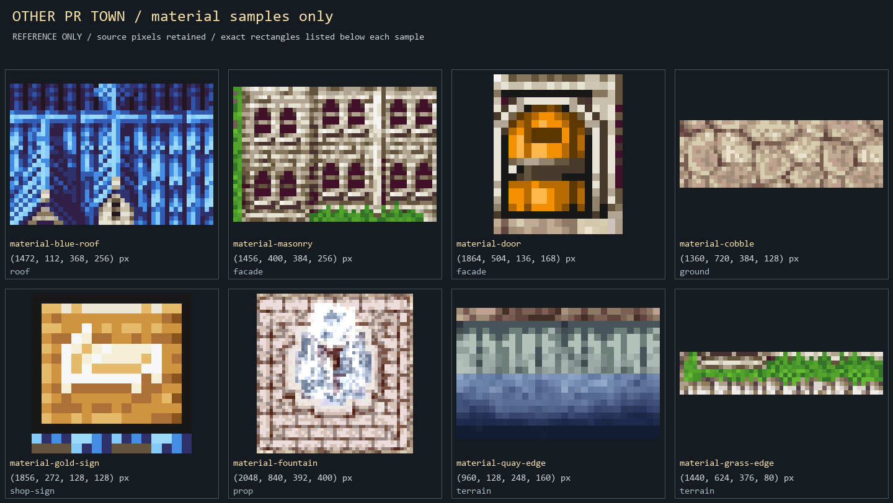

# Pixel Remaster reference decomposition for AltairKitV1

The verified **Altair sepia map** supplies town topology and building silhouettes. The **color PR town screenshot is a different, unconfirmed town** and supplies materials only. These two sources must not be blended into an assertion that Altair has the color screenshot's canal, quay or street plan.

This breakdown preserves the original source files and provides **26 unpainted rectangular PNG crops**, two labeled contact sheets and two source images annotated with crop rectangles. Crop files retain their exact source pixels and native sizes. Contact sheets use nearest-neighbor presentation scaling only. They are reference samples, not transparent game-ready assets or reconstructed hidden surfaces.

## Visual sheets

The [annotated Altair map](../../References/AltairKitV1/altair-annotated-crops.png) and [annotated color material source](../../References/AltairKitV1/materials-annotated-crops.png) show every crop in its original context. The [machine-readable manifest](../../References/AltairKitV1/crop-manifest.json) records source URLs, scope, dimensions, original-file SHA-256, crop rectangles and crop SHA-256.

## What the decomposition establishes

- **Roofs:** the Altair headquarters has a long north roof and a deep east wing; the sanctuary has a wider, distinct gabled silhouette. The color study shows slate material and ridge highlights, without establishing Altair's roof hue.
- **Facades:** pale masonry/timber, window rhythm, projecting gables and doors are separate from roof silhouettes. A front-facing doorway must line up with the engine's service approach; resizing a whole structure does not fix an off-center door.
- **Ground:** Altair's western civic space is a broad paved plaza, not a thin road network. Its fountain interrupts the paving and has solid occupancy.
- **Shop symbols:** the verified map visibly distinguishes item, inn, armor, weapon and magic services. These are map symbols in the source, not proof that the blue icons float above roofs during gameplay. The other town shows a physical gold roof-mounted sign; the generated kit may use separate sign layers.
- **Terrain:** Altair's pale U-shaped item-shop enclosure is masonry, while the eastern dividers are natural raised terraces with explicit stairs. The other town's colored quay sample is material research only and must not introduce a canal into Altair.

## Layer authoring contract

Production facade/roof/trim PNGs are generated separately under `Assets/Art/Production/AltairKitV1/`; none of these reference crops is bound by the game. Each building's facade and roof must use the same transparent canvas and reconstruct the accepted generated master when composited. The headquarters keeps the southwest notch transparent. Ground, cliff edges/steps, structure facade, roof/trim, signs/props and actors remain separate runtime responsibilities.

These crops do not recover surfaces hidden behind signs, roofs or map overlays. No inpainting, recoloring, alpha extraction or claim of original tile-sheet ownership is made. The engine owns collision and portal coordinates separately from reference image boundaries.

## Source provenance

### altair

- Source page: [https://vorxu.com/final-fantasy-2-pixel-remaster/walkthrough/altair-and-fynn](https://vorxu.com/final-fantasy-2-pixel-remaster/walkthrough/altair-and-fynn)
- Image: [https://cdn.vorxu.com/images/final-fantasy-2-pixel-remaster/towns/altair-start-game.png](https://cdn.vorxu.com/images/final-fantasy-2-pixel-remaster/towns/altair-start-game.png)
- Preserved local source: [`sources/altair-pr.png`](../../References/AltairKitV1/sources/altair-pr.png)
- Dimensions: 1776 x 1617 pixels
- SHA-256: `336ccb6f6863261abba7c34fa36aa4a0781eb6c5bd3b2fe1aa3c9d28908ca426`
- Scope: Actual Altair PR in-game sepia map: topology and architectural silhouette only.

### materials

- Source page: [https://klardendum.com/review/o-tempora-final-fantasy-ii-pixel-remaster/](https://klardendum.com/review/o-tempora-final-fantasy-ii-pixel-remaster/)
- Image: [https://klardendum.com/wp-content/uploads/2021/11/ff2pr1.jpg](https://klardendum.com/wp-content/uploads/2021/11/ff2pr1.jpg)
- Preserved local source: [`sources/pr-town-materials.jpg`](../../References/AltairKitV1/sources/pr-town-materials.jpg)
- Dimensions: 2560 x 1440 pixels
- SHA-256: `b7a1e7863d75718801f01727620d8a88255039d8ce42f10e7308dc68174b8404`
- Scope: Different PR town, identity unconfirmed: palette/material vocabulary only; never Altair geography.

Original Final Fantasy II Pixel Remaster imagery remains attributable to Square Enix and the cited publishers/capturers. Keeping these reference files grants no new license, ownership or endorsement. This folder is research material outside Unity's production asset tree.

## Exact crop rectangles

Coordinates are `(x, y, width, height)` in the original source image. Right/bottom edges are excluded. Each filename links to a native-size PNG crop.

| PNG | Source | Component | Rectangle (pixels) |
|---|---|---|---|
| [altair-item-shop](../../References/AltairKitV1/crops/altair-item-shop.png) | altair | object | `(442, 286, 115, 157)` |
| [altair-inn](../../References/AltairKitV1/crops/altair-inn.png) | altair | object | `(442, 496, 187, 167)` |
| [altair-headquarters](../../References/AltairKitV1/crops/altair-headquarters.png) | altair | object | `(664, 496, 262, 317)` |
| [altair-sanctuary](../../References/AltairKitV1/crops/altair-sanctuary.png) | altair | object | `(1102, 188, 264, 184)` |
| [altair-armor-shop](../../References/AltairKitV1/crops/altair-armor-shop.png) | altair | object | `(442, 1018, 187, 169)` |
| [altair-weapons-smithy](../../References/AltairKitV1/crops/altair-weapons-smithy.png) | altair | object | `(962, 866, 264, 241)` |
| [altair-roof-main](../../References/AltairKitV1/crops/altair-roof-main.png) | altair | roof | `(667, 499, 251, 94)` |
| [altair-facade-main](../../References/AltairKitV1/crops/altair-facade-main.png) | altair | facade | `(668, 591, 148, 73)` |
| [altair-plaza-ground](../../References/AltairKitV1/crops/altair-plaza-ground.png) | altair | ground | `(449, 882, 355, 123)` |
| [altair-item-symbol](../../References/AltairKitV1/crops/altair-item-symbol.png) | altair | shop-sign | `(462, 317, 79, 65)` |
| [altair-inn-symbol](../../References/AltairKitV1/crops/altair-inn-symbol.png) | altair | shop-sign | `(539, 543, 73, 54)` |
| [altair-armor-symbol](../../References/AltairKitV1/crops/altair-armor-symbol.png) | altair | shop-sign | `(471, 1051, 66, 66)` |
| [altair-weapon-symbol](../../References/AltairKitV1/crops/altair-weapon-symbol.png) | altair | shop-sign | `(984, 905, 80, 79)` |
| [altair-magic-symbol](../../References/AltairKitV1/crops/altair-magic-symbol.png) | altair | shop-sign | `(1279, 682, 75, 75)` |
| [altair-fountain](../../References/AltairKitV1/crops/altair-fountain.png) | altair | prop | `(632, 791, 79, 88)` |
| [altair-courtyard-wall](../../References/AltairKitV1/crops/altair-courtyard-wall.png) | altair | terrain | `(364, 214, 264, 76)` |
| [altair-cliff-steps](../../References/AltairKitV1/crops/altair-cliff-steps.png) | altair | terrain | `(955, 297, 89, 146)` |
| [altair-cliff-rim](../../References/AltairKitV1/crops/altair-cliff-rim.png) | altair | terrain | `(741, 359, 221, 58)` |
| [material-blue-roof](../../References/AltairKitV1/crops/material-blue-roof.png) | materials | roof | `(1472, 112, 368, 256)` |
| [material-masonry](../../References/AltairKitV1/crops/material-masonry.png) | materials | facade | `(1456, 400, 384, 256)` |
| [material-door](../../References/AltairKitV1/crops/material-door.png) | materials | facade | `(1864, 504, 136, 168)` |
| [material-cobble](../../References/AltairKitV1/crops/material-cobble.png) | materials | ground | `(1360, 720, 384, 128)` |
| [material-gold-sign](../../References/AltairKitV1/crops/material-gold-sign.png) | materials | shop-sign | `(1856, 272, 128, 128)` |
| [material-fountain](../../References/AltairKitV1/crops/material-fountain.png) | materials | prop | `(2048, 840, 392, 400)` |
| [material-quay-edge](../../References/AltairKitV1/crops/material-quay-edge.png) | materials | terrain | `(960, 128, 248, 160)` |
| [material-grass-edge](../../References/AltairKitV1/crops/material-grass-edge.png) | materials | terrain | `(1440, 624, 376, 80)` |

## Reproduction and verification

From the AI-Art-FF2 checkout, run `python References/AltairKitV1/extract-reference.py` while the preserved original download inputs remain in the sibling game checkout's `Logs/altair-reference-20261030/`. The script preserves existing files, refuses differing output bytes, and writes only this reference directory. The doc is kept separately here. Pillow is the only image dependency.

Validation: both sheets were visually inspected; the individual roof, facade, paving, shop-symbol, fountain, wall, cliff and stair samples are visible and correctly scoped. All crops were compared byte-for-byte after decoding to their declared source rectangles, and the manifest hashes were checked. These are visual research artifacts, not runtime or gameplay validation.
