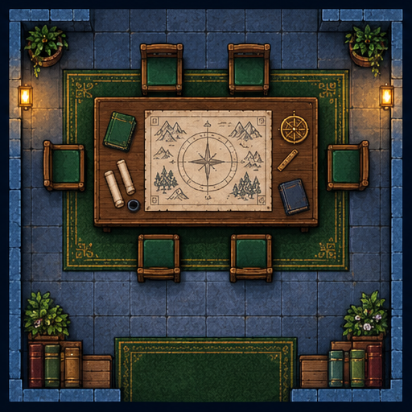
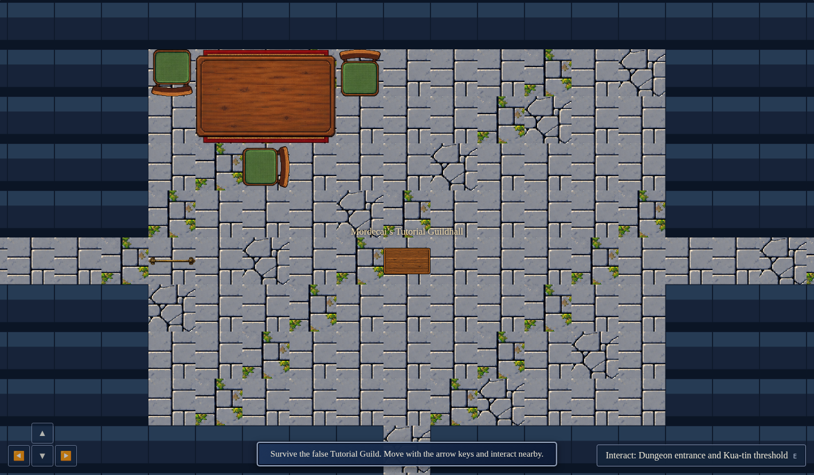
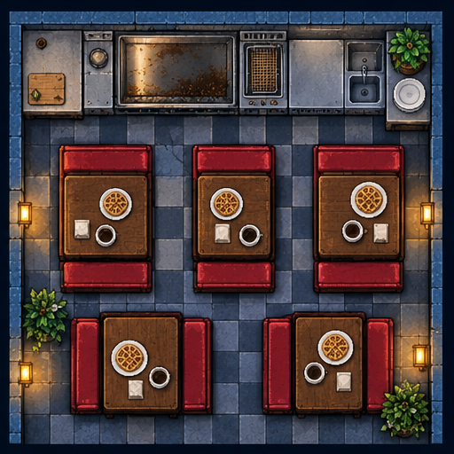
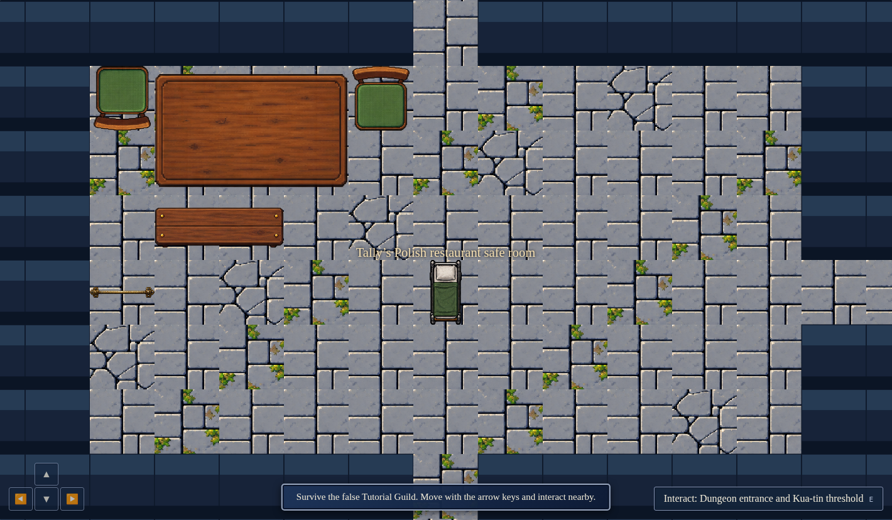
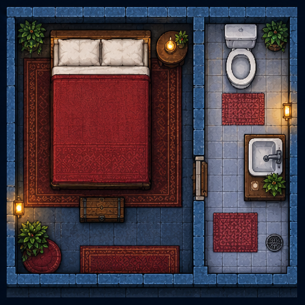
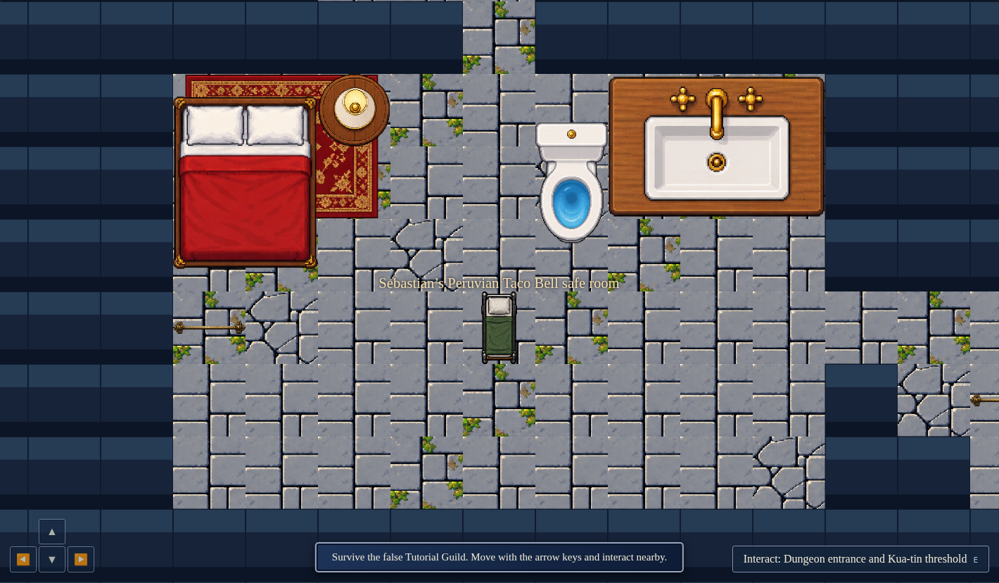

# Concept and runtime room comparison

The paired captures below show source concepts beside seeded runtime rooms. The runtime images use the published game renderer with browser-only camera framing; surrounding page HUD is omitted, while in-canvas controls remain visible. These are visual comparisons, not pixel-difference measurements or canonical floor plans. The F35 guild sheet is a generic crawler-guild concept, not a literal plan of Mordecai’s canonical Tutorial Guildhall. F33 is the generic Waffle House diner concept used only as layout inspiration for Tally’s restaurant. F36 is a generic safe-room concept, not a measured layout for Sebastian’s room.

## Guild hall — F35

| Reference concept | Runtime room |
| --- | --- |
|  |  |

Both have a large teaching table, wood furniture, stone floor, and clear floor around the focal furniture. The runtime table and chairs are pushed to the upper-left instead of forming the reference’s central map-table grouping; a rug is present but mostly occluded beneath the table, and there is no visible map. Most seats are missing. The runtime’s large uninterrupted floor and sharp tile cracks/green growth make its texture busier, while the reference uses a darker blue slate palette, warm wall lights, plants, and book stacks to anchor the corners.

## Dining room — F33

| Reference concept | Runtime room |
| --- | --- |
|  |  |

The runtime retains wood dining furniture and a stone floor, but it does not reproduce the reference’s defining service-and-seating pattern: the long counter is absent, the five compact booth/table bays become a large table plus a bench, and aisles between repeated booths disappear. Relative to the reference’s evenly distributed, moderately dense dining layout, runtime props are sparse and concentrated near the upper-left. The tiled floor is brighter and more cracked; the reference’s darker slate, red booths, metallic counter, lamps, and corner plants give it more color separation and a stronger restaurant identity.

## Bedroom / washroom — F36

| Reference concept | Runtime room |
| --- | --- |
|  |  |

Both compositions separate a bed from toilet/sink fixtures, so the broad rest-versus-wash zoning reads. The runtime leaves the zones open on one shared floor, without the reference’s thick partition and single connecting opening; its bed, toilet, and oversized sink sit as isolated props with little corner dressing. The reference’s two distinct floor treatments, rugs, bedside lamp, and plants make the zones warmer and more finished. Runtime stone remains visually busy and cool, with fewer rugs and no bath mats.

Across the three rooms, the strongest shared cues are overhead presentation, stone flooring, and recognizable furniture silhouettes. The largest visible gap is composition: runtime furniture is smaller in number and often clustered away from the center, while the concepts use corner anchors, distinct focal groupings, and stronger room-specific palettes. The captures are one seeded runtime state and do not establish a universal or canonically measured floor plan.
