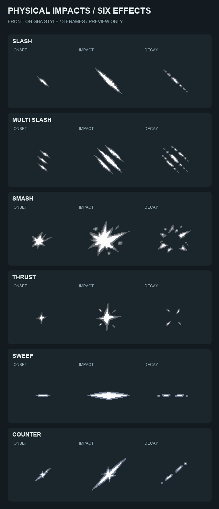
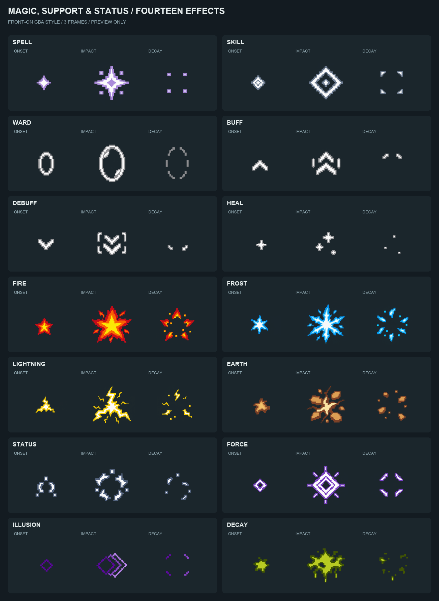
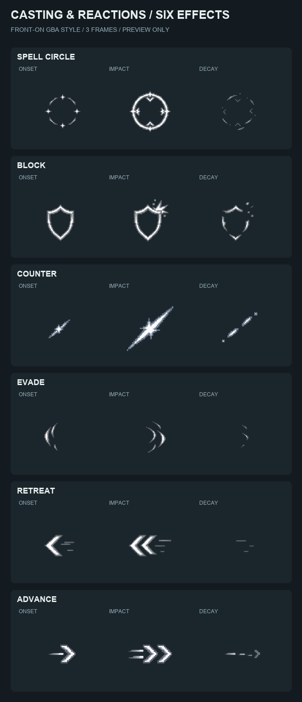
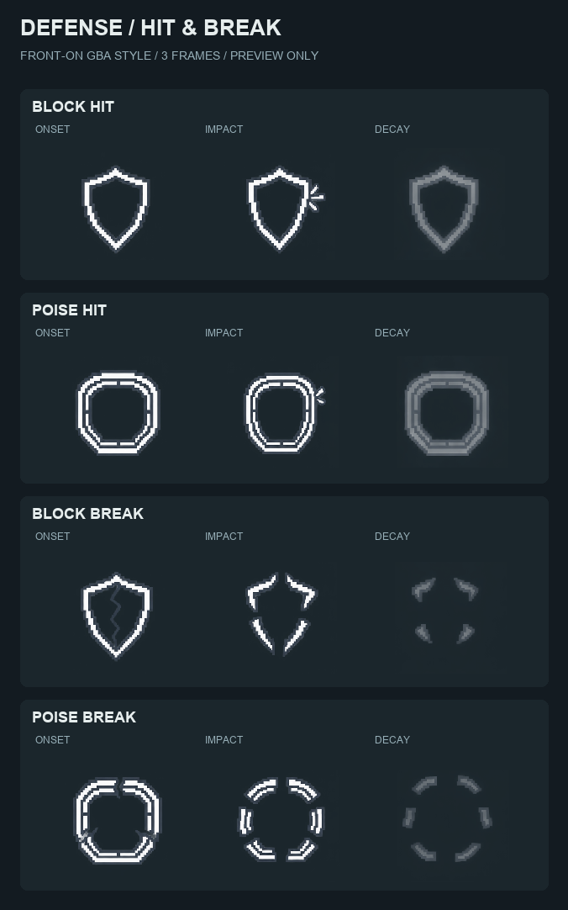
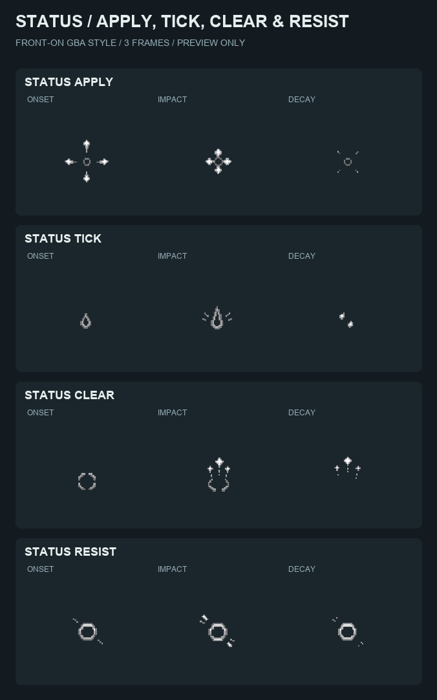
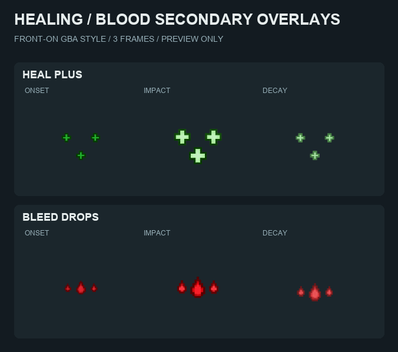

# Recipient impact effects v5

This reviewed source package accompanies 35 original recipient-effect strips in
`hd/assets/recipient-effects/v5/` and their byte-identical PNG twins in
`light/assets/recipient-effects/v5/`. Every runtime strip is transparent RGBA,
768 x 256 pixels: three registered 256 x 256 frames. No existing asset is replaced.

Generated with OpenAI image generation under Constantine Hinds' direction.
Original prompt JSONs, raw PNGs (including superseded studies), extraction
records and scripts are retained unchanged. No third-party artwork was downloaded
and no third-party licence is asserted. The catalog's staging-purpose text records
its origin; it does not claim that these assets have been released or pinned.

## Review













All shapes face the viewer. Slash is one cut; Multi-slash is three; Smash is an
asymmetric comic impact. Sweep is one horizontal cut played once per group action.
The single spell-circle is tinted procedurally; no school-specific circles are
baked. Elements are separate overlays. Block and Poise use distinct shield forms.

Ward and Evade use the actual protected/reacting actor's mask in the game. The
human `evade-afterimage` study is preserved as provenance, never runtime art.
Buff/debuff use the same card-bottom aura with semantic tints, including WIS, SP
and MP. `heal-plus` is three green plus marks in a V, moving up in the game;
`bleed-drops` is red droplets moving down, starting at the primary's last frame.
The legacy `heal` sparkle is retained as a library shape; healing uses `heal-plus`.
These contacts show source frames; procedural tint, motion, opacity and actor masks
are owned by AshenSpire's recipient-effects JSON and renderer.

## Reproduce and verify

`recipient-effects-catalog.json` is the exact intake catalog. Its `tiers` and
`provenance.*.path` fields are repository-relative; `entries.*.source` is relative
to this source package. Its JSON Schema is beside it.

Copy this whole source directory to a separate working directory before re-running
extraction, so original evidence remains untouched. With Python and Pillow:

```text
python front-on-v4/exporter.py
python composed-v5/export-additions.py
python overlay-v6/export.py
```

The scripts preserve raw alpha, use nearest-neighbour scaling, and share one
registration/scale across all three frames. The Poise revision `defense-v2.png`
is selected over the preserved original `defense.png`. Compare exported strips
against the catalog's SHA256 values before intake. The demonstration afterimage
is excluded from the 35 catalog entries.

From the art repository root, the automated byte/source check is:

```text
node --test tests/recipient-effects.test.mjs
node tools/mobile-art.mjs
node tools/manifest.mjs --write
node tools/mobile-art.mjs --check
node tools/manifest.mjs --check
node tools/pack.mjs --check
```

The PNG policy copies bytes verbatim into the light tier. Only the existing twin
and manifest tools write their derived metadata. No release version is changed. `release.json` pins this exact catalog hash while
keeping `preserveMigratedAssetBytes: true`. The release verifier checks each new
PNG and manifest row, removes only the listed additions to validate the original
snapshot, checks the complete new archives, then reconstructs the original
high/light archives and requires their historical SHA256 values. PR CI runs this
same read-only candidate verification; an unlisted addition or old-byte change
still fails.
Merging into `ashenspire` triggers publication automatically: this PR must remain
unmerged until that separate release action is authorized.
