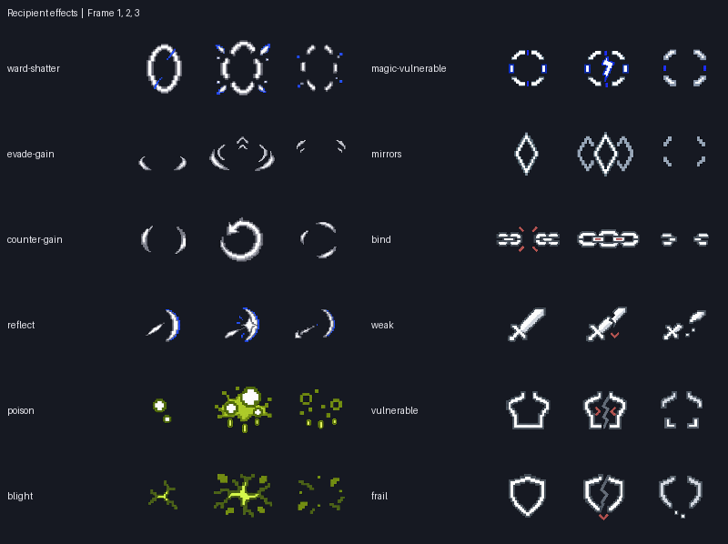
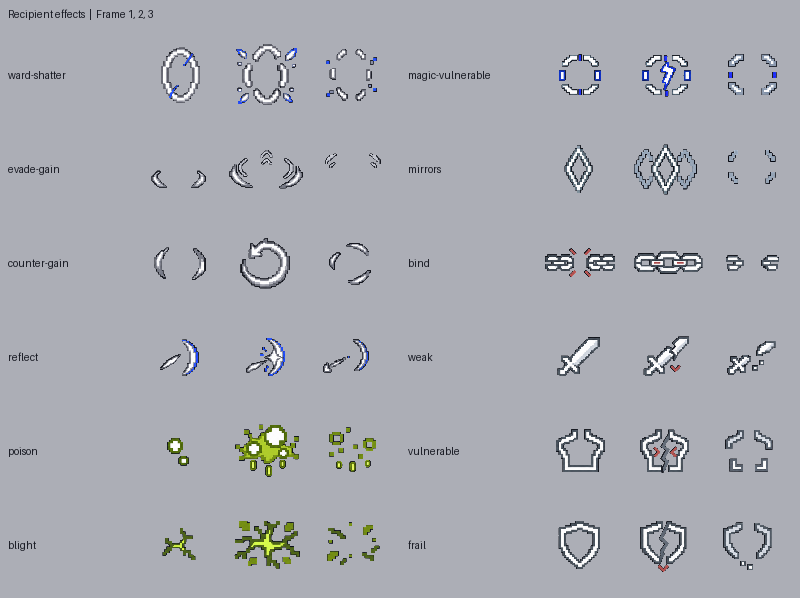

# Recipient-effect animation sequences v6

Twelve new three-frame pixel-art effects accompany the existing v5 collection.
The v6 runtime exports are transparent RGBA, 768 × 256 pixels, and have
byte-identical HD and light versions.

Generated with OpenAI image generation under Constantine Hinds' direction.
The approved animation boards, alpha edits and prompts are included.
The catalog records the approved RGB board, generated alpha source,
registration, frame crops, common scale and SHA-256 for every strip.
The rejected standalone Magic Vulnerable edit is included as review evidence.
No third-party artwork or Creative Commons license is claimed.

## Frame review

## Packing

The packer composites the generated alpha over the approved RGB pixels.
For the defense board, nearest-neighbor alignment normalizes the generated
1438-wide image to the approved width before applying the alpha. The alpha
noise floor comes from the catalog. Each frame is clipped to its original
board cell and placed on a shared 372 × 372 source viewport around the
catalog's source frame center. Nearest-neighbor scaling maps it to a 256 ×
256 tile with a centered anchor. The three tiles are packed in frame order.

`release.json` pins the v6 catalog independently of the v5 catalog.
